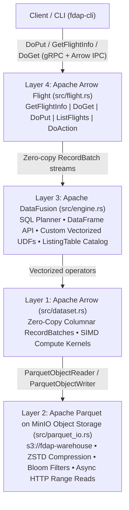

# The FDAP Stack in Rust — Presentation

> **Interactive Slide Deck (Browser):**
> - **GitHub Pages:** [https://heikofkoehler.github.io/fdap/presentation/](https://heikofkoehler.github.io/fdap/presentation/)
> - **GitHub HTML Preview:** [Open Interactive Deck via `htmlpreview.github.io`](https://htmlpreview.github.io/?https://github.com/heikofkoehler/fdap/blob/main/presentation/index.html)
> - **Marp / Markdown Source:** [`presentation/SLIDES.md`](SLIDES.md)

---

## Slide 1: Why the FDAP Stack?

Traditional analytical engines spend **70–80% of CPU cycles** serializing and converting data between incompatible storage, execution, and wire formats.

The **FDAP** stack eliminates format translation by standardizing every layer around **Apache Arrow**:

| Layer | Technology | Role in [`heikofkoehler/fdap`](https://github.com/heikofkoehler/fdap) |
| :--- | :--- | :--- |
| **F — Flight** | [Apache Arrow Flight](https://arrow.apache.org/docs/format/Flight.html) | Streams Arrow IPC `RecordBatch`es over HTTP/2 gRPC (`DoGet`, `DoPut`, `GetFlightInfo`, `DoAction`) with zero row serialization overhead ([`src/flight.rs`](../src/flight.rs)). |
| **D — DataFusion** | [Apache DataFusion](https://datafusion.apache.org/) | Vectorized SQL & DataFrame query engine with custom UDFs (`sla_tier`, `saturation_score`) and Parquet filter/projection pushdown ([`src/engine.rs`](../src/engine.rs)). |
| **A — Arrow** | [Apache Arrow](https://arrow.apache.org/) | In-memory columnar arrays, validity bitmaps, dictionary encoding, zero-copy `slice()`, and SIMD compute kernels ([`examples/01_arrow.rs`](../examples/01_arrow.rs)). |
| **P — Parquet** | [Apache Parquet](https://parquet.apache.org/) + **MinIO** | ZSTD-compressed columnar storage on `s3://fdap-warehouse` with row groups, column min/max statistics, Bloom filters, and async S3 HTTP Range reads ([`src/parquet_io.rs`](../src/parquet_io.rs), [`src/storage.rs`](../src/storage.rs)). |

---

## Slide 2: End-to-End Architecture



---

## Slide 3: Layer 1 — Apache Arrow ([`examples/01_arrow.rs`](../examples/01_arrow.rs))

**Run:** `cargo run --example 01_arrow`

- **Columnar Memory Layout**: Contiguous typed value buffers + optional validity bitmaps (`NullBuffer`), `DictionaryArray<Int32Type>` for low-cardinality `region` strings, and nested `StructArray` for host placement (`{ rack, az }`).
- **Zero-Copy Slicing**: `batch.slice(1, 3)` shares the underlying `Buffer` allocation (`orig_ptr + 8 == slice_ptr`).
- **Vectorized Compute Kernels (`arrow::compute`)**:
  ```rust
  // Vectorized subtraction: headroom_ms = sla_budget_ms - latency_ms
  let headroom = sub(budget_col, lat_col)?;

  // Vectorized boolean predicate filter: latency_ms >= sla_budget_ms
  let breach_mask: BooleanArray = gt_eq(lat_col, budget_col)?;
  let breached_batch = filter_record_batch(&batch, &breach_mask)?;

  // Top-3 sort using lexsort_to_indices + take_record_batch
  let sort_indices = lexsort_to_indices(&[SortColumn {
      values: batch.column_by_name("latency_ms").unwrap().clone(),
      options: Some(SortOptions { descending: true, nulls_first: false }),
  }], Some(3))?;
  let top3_batch = take_record_batch(&batch, &sort_indices)?;
  ```

---

## Slide 4: Layer 2 — Apache Parquet on MinIO ([`examples/02_parquet.rs`](../examples/02_parquet.rs))

**Run:** `cargo run --example 02_parquet`

1. **Async Multipart Write to MinIO (`ParquetObjectWriter` + `AsyncArrowWriter`)**:
   - Writes 150 rows across 3 row groups with `Compression::ZSTD(3)`, page-level statistics, and Bloom filters on `device_id` and `service`.
2. **Footer-Only Inspection via S3 Range Read (`ParquetObjectReader`)**:
   - Fetches only the Parquet footer from `s3://fdap-warehouse/examples/telemetry_demo.parquet` to inspect row group sizes and column chunk `min`/`max` statistics.
3. **Three-Stage Read Pruning**:
   - **Row Group Pruning**: Skips row groups whose `max(latency_ms) < 380.0`.
   - **Late Materialization (`RowFilter` / `ArrowPredicateFn`)**: Evaluates `latency_ms >= 380.0` before decoding other columns.
   - **Column Projection (`ProjectionMask`)**: Fetches only the 5 requested columns out of 10 from MinIO.

---

## Slide 5: Layer 3 — Apache DataFusion ([`examples/03_datafusion.rs`](../examples/03_datafusion.rs))

**Run:** `cargo run --example 03_datafusion`

- **MinIO `ObjectStore` Registration**:
  ```rust
  ctx.runtime_env().register_object_store(&bucket_url, storage.as_object_store());
  ```
- **Custom Vectorized Scalar UDFs ([`src/engine.rs`](../src/engine.rs))**:
  - `sla_tier(latency_ms, is_error)` $\rightarrow$ `'CRITICAL' | 'DEGRADED' | 'NORMAL' | 'FAST'`
  - `saturation_score(cpu_pct, memory_mb)` $\rightarrow$ weighted `[0.0 .. 100.0]` resource saturation index
- **Physical Plan Pushdown Verification (`EXPLAIN`)**:
  ```text
  SortPreservingMergeExec: [latency_ms@3 DESC], fetch=5
    SortExec: TopK(fetch=5), expr=[latency_ms@3 DESC]
      FilterExec: latency_ms@3 > 200 AND is_error@4, projection=[event_id@0, device_id@1, service@2, latency_ms@3]
        RepartitionExec: partitioning=RoundRobinBatch(4), input_partitions=2
          DataSourceExec:
            file_groups={2 groups: [[tables/telemetry/part-1.parquet], [tables/telemetry/part-2.parquet]]},
            projection=[event_id, device_id, service, latency_ms, is_error],
            file_type=parquet,
            predicate=latency_ms@7 > 200 AND is_error@9,
            pruning_predicate=latency_ms_null_count@1 != row_count@2 AND latency_ms_max@0 > 200 AND (is_error_min@3 OR is_error_max@4)
  ```

---

## Slide 6: Layer 4 — Apache Arrow Flight ([`examples/04_flight.rs`](../examples/04_flight.rs))

**Run:** `cargo run --example 04_flight`

- **`GetFlightInfo` + `DoGet`**: Plans SQL queries in DataFusion, returns the Arrow schema + `Ticket`, and streams `RecordBatch`es over HTTP/2 gRPC via `FlightDataEncoderBuilder`.
- **`DoPut`**: Streams Arrow `RecordBatch`es from client to server via `FlightRecordBatchStream`, writes a new Parquet partition to MinIO (`s3://fdap-warehouse/tables/<table>/part-<uuid>.parquet`), and registers the table in DataFusion.
- **`ListFlights` & `DoAction`**: Exposes catalog metadata (`list_tables`), execution plans (`explain`), warehouse seeding (`seed_warehouse`), and health checks (`ping`).

---

## Slide 7: Unified FDAP Query Engine ([`examples/05_fdap_query_engine.rs`](../examples/05_fdap_query_engine.rs))

**Run:** `cargo run --example 05_fdap_query_engine`

1. Automatically starts local MinIO (if not already running) and bootstraps `s3://fdap-warehouse`.
2. Seeds `telemetry` (400 rows across 2 Parquet files), `devices` (8 rows), and `incidents` (5 rows) via Flight `seed_warehouse`.
3. Streams 50 live `telemetry` rows via Flight `DoPut` into a 3rd Parquet partition on MinIO (450 total rows).
4. Runs analytical SQL queries over Flight (`GetFlightInfo` $\rightarrow$ `DoGet`):
   - **Regional Fleet Health** with custom vectorized UDFs (`saturation_score`, `sla_tier`)
   - **3-Way Incident Impact Join** (`incidents` $\bowtie$ `devices` $\bowtie$ `telemetry`)
   - **Regional Tail-Latency Outliers** using `ROW_NUMBER() OVER (PARTITION BY region ORDER BY latency_ms DESC)`
